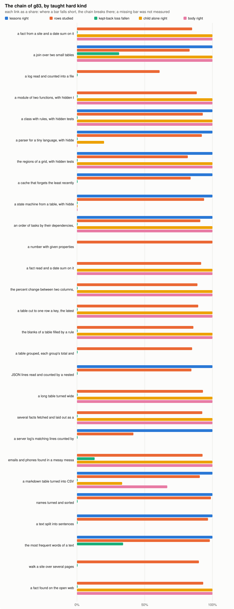

# The read of g79

Run [45567825482](https://github.com/Arnav123-s/HiveMIND/actions/runs/45567825482), recorded 2026-11-25 12:47: the body was **dropped**. dropped: 49 against 50; after 49 of 64 (easy 31 of 32, hard 18 of 32), before 50 of 64 (easy 31 of 32, hard 19 of 32) on 8 seeds

Written by the record job (`training/reads.py`), with nobody's hand. The rules are those of `docs/DECISIONS.md`.

## The numbers

| What is measured | g79 | g75 (last record) | the body before (same seeds) |
|---|---|---|---|
| Easy kinds passed | 31 of 32 | 31 of 32 | 31 of 32 |
| Hard kinds that have lessons | 18 of 22 | 21 of 27 | 19 of 22 |
| Hard kinds never practised (held out) | 1 of 10 kinds (2 of 27 tasks of the fixed exam; pulse 0 of 10) | 1 of 10 kinds (2 of 30 tasks of the fixed exam; pulse 0 of 5) | 2 of 10 kinds (4 of 27 tasks of the fixed exam; pulse 0 of 10) |
| Right at the first try (practice) | 0.61 (59 of 96) | 0.59 | - |
| Right at the first try, old kinds and K2's new kinds (practice) | old kinds 0.87 (33 of 38); new kinds (K2) 0.45 (26 of 58) | old kinds 0.92 (34 of 37); new kinds (K2) 0.39 (23 of 59) | - |
| Hours for one generation | 5.4 | - | - |
| Generations recorded with nobody's hand | 0 | 0 | - |
| Talk (the talk exam, out of 10; the bar is 8) | 8.0 of 10 (route 8 of 10, fact 10 of 10, earlier 7 of 10, time 7 of 10) | 8.2 of 10 (route 8 of 10, fact 9 of 10, earlier 10 of 10, time 6 of 10) | - |

## What members solved and what reached the user

| Exam arm | Scope | Graded for both, of tasks sat | Any recorded member passed | Final delivery passed | Member passed, delivery failed | Delivery passed, no recorded member passed |
|---|---|---:|---:|---:|---:|---:|
| before | all | 64 of 64 | 52 | 50 | 2 | 0 |
| before | hard | 32 of 32 | 20 | 19 | 1 | 0 |
| after | all | 64 of 64 | 52 | 49 | 3 | 0 |
| after | hard | 32 of 32 | 21 | 18 | 3 | 0 |

Counts compare the task checker on recorded member answers and their files with the same checker on the final delivery. Only tasks with a known result on both sides enter the last four columns.

## Which final deliveries changed

Comparable deliveries: 64 matched, from 64 tasks sat before and 64 after. Matching requires the same seat, task ID, prompt, kind and exam revision.

| Gained | Lost | Passed both | Failed both |
|---:|---:|---:|---:|
| 0 | 1 | 49 | 14 |

Lost: `h20000797_00` (a text split into sentences).

## The chain, by taught hard kind

lessons right by their own check -> rows that fit in training -> loss falls on lessons kept back -> the child alone writes it at the exam -> the body (two agree) passes it.

| kind | lessons right of made | rows left out | kept-back loss before -> after | gap to untaught (points) | child alone right | parent alone right | body right | body before |
|---|---|---|---|---|---|---|---|---|
| a fact from a site and a date sum on it | none made | 34 of 260 (47 skipped for memory) | 0.001 -> 0.002 | -164 | 1 of 1 | - | 1 of 1 | 1 of 1 |
| a join over two small tables | none made | 139 of 262 (43 skipped for memory) | not measured | not measured | - | - | - | - |
| a log read and counted into a file | none made | 127 of 163 (24 skipped for memory) | 0.000 -> 0.001 | -32 | - | - | - | - |
| a module of two functions, with hidden tests | none made | 269 of 820 (202 skipped for memory) | 0.118 -> 0.150 | +2 | 1 of 1 | - | 1 of 1 | 1 of 1 |
| a class with rules, with hidden tests | 12 of 12 | 201 of 723 (164 skipped for memory) | 0.023 -> 0.022 | +33 | 1 of 1 | - | 1 of 1 | 1 of 1 |
| a parser for a tiny language, with hidden tests | 12 of 12 | 161 of 620 (118 skipped for memory) | 0.005 -> 0.011 | -69 | - | - | - | - |
| the regions of a grid, with hidden tests | 12 of 12 | 176 of 620 (183 skipped for memory) | 0.003 -> 0.005 | -22 | 1 of 1 | - | 1 of 1 | 1 of 1 |
| a cache that forgets the least recently used, with hidden tests | 12 of 12 | 224 of 705 (143 skipped for memory) | 0.025 -> 0.028 | +18 | 0 of 2 | - | 0 of 2 | 0 of 2 |
| a state machine from a table, with hidden tests | 12 of 12 | 82 of 520 (141 skipped for memory) | 0.003 -> 0.011 | -199 | 0 of 1 | - | 0 of 1 | 0 of 1 |
| an order of tasks by their dependencies, with hidden tests | 12 of 12 | 220 of 962 (336 skipped for memory) | 0.003 -> 0.006 | -55 | 2 of 2 | - | 2 of 2 | 2 of 2 |
| a number with given properties | none made | 9 of 220 (22 skipped for memory) | 0.123 -> 0.131 | +23 | 1 of 1 | - | 1 of 1 | 1 of 1 |
| a fact read and a date sum on it | none made | 24 of 60 (14 skipped for memory) | 0.002 -> 0.007 | -242 | - | - | - | - |
| the percent change between two columns, rounded by a rule | none made | 146 of 480 (125 skipped for memory) | 0.003 -> 0.003 | +31 | 2 of 2 | - | 2 of 2 | 2 of 2 |
| a table cut to one row a key, the latest kept | none made | 208 of 420 (78 skipped for memory) | 0.002 -> 0.003 | -83 | 1 of 1 | - | 1 of 1 | 1 of 1 |
| the blanks of a table filled by a rule | none made | 72 of 120 (34 skipped for memory) | 0.001 -> 0.002 | -116 | 1 of 1 | - | 1 of 1 | 1 of 1 |
| a table grouped, each group's total and mean saved | none made | 129 of 340 (89 skipped for memory) | 0.001 -> 0.002 | -72 | 2 of 2 | - | 2 of 2 | 2 of 2 |
| JSON lines read and counted by a nested field | 13 of 13 | 216 of 780 (78 skipped for memory) | 0.000 -> 0.000 | +26 | 2 of 2 | - | 2 of 2 | 2 of 2 |
| a long table turned wide | none made | 60 of 200 (57 skipped for memory) | 0.001 -> 0.002 | -46 | - | - | - | - |
| several facts fetched and laid out as a file | none made | 19 of 280 (42 skipped for memory) | 0.001 -> 0.002 | -30 | - | - | - | - |
| a server log's matching lines counted by class | 13 of 13 | 242 of 780 (78 skipped for memory) | 0.009 -> 0.016 | -50 | - | - | - | - |
| emails and phones found in a messy message | none made | 52 of 160 (44 skipped for memory) | 0.021 -> 0.024 | +15 | - | - | - | - |
| a markdown table turned into CSV | 13 of 13 | 225 of 1002 (184 skipped for memory) | 0.003 -> 0.003 | +43 | - | - | - | - |
| names turned and sorted | 14 of 14 | 0 of 600 (100 skipped for memory) | 0.001 -> 0.001 | -11 | - | - | - | - |
| a text split into sentences | none made | 86 of 225 (48 skipped for memory) | 0.037 -> 0.041 | +20 | 1 of 2 | 1 of 2 | 0 of 1 | 1 of 1 |
| the most frequent words of a text | 12 of 12 | 51 of 580 (94 skipped for memory) | 0.643 -> 0.088 | +115 | 2 of 2 | - | 2 of 2 | 2 of 2 |
| walk a site over several pages | none made | not measured | 0.000 -> 0.001 | -144 | - | - | - | - |
| a fact found on the open web | none made | 47 of 282 (32 skipped for memory) | 0.002 -> 0.006 | -116 | 1 of 1 | - | 1 of 1 | 1 of 1 |

- rows left out: by kind, this generation's rows too long for a slice, of those the slices were given; in brackets those the memory guard skipped every time they came up. Rows not reached before the time was up are not left out
- gap: the kind's fall beside the mean fall of the kinds with no lesson this generation (operate a website, scrape a page to a file: -29 points)
- child alone: the answers of this generation's cells (8) in the pulse; parent alone: those of their parents (g72code, g72code2, g72data, g72data2, g72sources, g72sources2, g72words, g72words2) in every arm. Two members sit a task, so these are few

How much the hive taught itself: of this generation's new rows, 318 from the hive's own checked practice and dreams (6 of them fix rows), 336 from the hand-written lesson makers (training/lessons.py, training/kinds/): the hive's own are 49% of those two. Rows trained on: not measured by source (each slice's record says the rows it trained by kind only, rows_by_kind; a field rows_by_source {source: trained} would measure it).

## Hours

| step | minutes |
|---|---|
| practice | 31 |
| dream | 59 |
| gather | 12 |
| plan | 0 |
| train | 177 |
| join | 2 |
| merge | 2 |
| gate | 69 |
| record | 2 |

From the first job to the last: **5.39 hours** (the bar is 3). Each step runs from its first job's start to its last job's end; practice and dream run side by side.

Train slices lost: 0 of 20. Pulse seats whose server died: 0.

Colab: not used (notebook not seen)

## Next piece

next piece: dose: one change a generation: raw reading and judged pairs off; slices weighed by steps; the one-line trial (rule 3: kept-back gap under 15 points, for 17 of 27 taught hard kinds: a fact from a site and a date sum on it, a log read and counted into a file, a module of two functions, with hidden tests, a parser for a tiny language, with hidden tests, the regions of a grid, with hidden tests, a state machine from a table, with hidden tests, an order of tasks by their dependencies, with hidden tests, a fact read and a date sum on it, a table cut to one row a key, the latest kept, the blanks of a table filled by a rule, a table grouped, each group's total and mean saved, a long table turned wide, several facts fetched and laid out as a file, a server log's matching lines counted by class, names turned and sorted, walk a site over several pages, a fact found on the open web)

Rules that hold but whose piece is done on the board (docs/PLAN.md), so not named: rule 2 (T4); rule 6 (K1).

| # | the chain shows | holds for |
|---|---|---|
| 1 | lessons right under 8 of 12 | 0 |
| 2 | more than 1 row in 5 of the kind left out | 19: a join over two small tables, a log read and counted into a file, a module of two functions, with hidden tests, a class with rules, with hidden tests, a parser for a tiny language, with hidden tests, the regions of a grid, with hidden tests, a cache that forgets the least recently used, with hidden tests, an order of tasks by their dependencies, with hidden tests, a fact read and a date sum on it, the percent change between two columns, rounded by a rule, a table cut to one row a key, the latest kept, the blanks of a table filled by a rule, a table grouped, each group's total and mean saved, JSON lines read and counted by a nested field, a long table turned wide, a server log's matching lines counted by class, emails and phones found in a messy message, a markdown table turned into CSV, a text split into sentences (piece done) |
| 3 | kept-back gap under 15 points | 17: a fact from a site and a date sum on it, a log read and counted into a file, a module of two functions, with hidden tests, a parser for a tiny language, with hidden tests, the regions of a grid, with hidden tests, a state machine from a table, with hidden tests, an order of tasks by their dependencies, with hidden tests, a fact read and a date sum on it, a table cut to one row a key, the latest kept, the blanks of a table filled by a rule, a table grouped, each group's total and mean saved, a long table turned wide, several facts fetched and laid out as a file, a server log's matching lines counted by class, names turned and sorted, walk a site over several pages, a fact found on the open web |
| 4 | gap 15 or more, the child alone right more often than its parent, the body not | 0 |
| 5 | gap 15 or more, the child alone not right | 1: a cache that forgets the least recently used, with hidden tests |
| 6 | taught hard kinds 12 of 23, two generations running | 27 (piece done) |
